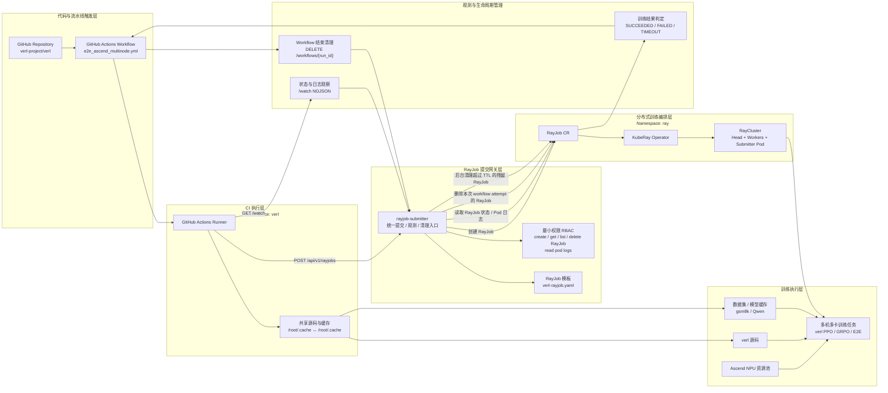

# rayjob-submitter

Internal HTTP service for GitHub Actions to submit, watch, and clean up KubeRay `RayJob` resources.

The service is template-driven: it loads `templates/verl-rayjob.yaml`, deep-copies it per request, and only patches image, entrypoint, labels, env, worker replicas, and whitelisted template paths requested through `template_patches`.

## Architecture


## Configuration

| Env | Default |
| --- | --- |
| `LISTEN_ADDR` | `:8080` |
| `TARGET_NAMESPACE` | `ray` |
| `RAYJOB_TEMPLATE_PATH` | `templates/verl-rayjob.yaml` |
| `WORKER_REPLICAS` | `2` |
| `MAX_WORKER_REPLICAS` | `2` |
| `ALLOWED_REPOSITORY` | `verl-project/verl` |
| `ALLOWED_IMAGE_PREFIXES` | `quay.io/ascend/verl:,quay.io/albert54/verl-ci:` |
| `LOG_HEAD_WAIT_SECONDS` | `1800` |
| `WATCH_TIMEOUT_SECONDS` | `12600` |
| `STATUS_POLL_SECONDS` | `30` |
| `STALE_RAYJOB_CLEANUP_ENABLED` | `true` |
| `STALE_RAYJOB_TTL_SECONDS` | `21600` |
| `STALE_RAYJOB_CLEANUP_INTERVAL_SECONDS` | `600` |
| `ALLOWED_SCRIPT_PREFIXES` | `tests/special_npu/,tests/special_e2e/,examples/data_preprocess/,/root/.cache/cicd_test/` |
| `MAX_ARGS` | `64` |
| `MAX_ARG_LENGTH` | `1024` |
| `MAX_EXTRA_ENV` | `64` |
| `MAX_ENV_VALUE_LENGTH` | `2048` |
| `MAX_TEMPLATE_PATCHES` | `32` |
| `MAX_TEMPLATE_PATCH_VALUE_LENGTH` | `2048` |

## Image publishing

The GitHub Actions workflow `.github/workflows/publish-image.yml` builds the
Dockerfile for `linux/amd64` and pushes to `quay.io/albert54/rayjob-submitter`.
It logs in as the Quay robot account `albert54+cisystem` using the GitHub Actions
secret `QUAY_TOKEN`. Give that robot write access to the Quay repository.

- **Tag push:** pushing a tag such as `v0.0.10` publishes
  `quay.io/albert54/rayjob-submitter:v0.0.10`. The tagged commit must be reachable
  from `main`; tags on other commits fail before building or publishing.
- **Manual:** open **Actions → Publish Docker image → Run workflow**, select
  `main` (or another ref whose commit is reachable from `main`), and optionally
  supply `image_tag`. Without that input, the workflow uses the selected Git tag
  or `sha-<full-commit-SHA>` for a branch run.

Tags must be valid Docker tags: at most 128 letters, digits, underscores, dots,
or hyphens, with no leading dot or hyphen. The workflow does not automatically
update `latest`. Publishing again with the same image tag replaces that tag.
For manual dispatch, the workflow must exist on the GitHub default branch.

After publishing, update the submitter image in `deploy/deployment.yaml` to the
new tag and apply it to deploy that version.

## Deployment

```bash
kubectl apply -f deploy/rbac.yaml
kubectl apply -f deploy/deployment.yaml
```

Local access:

```bash
kubectl -n ci-system port-forward svc/rayjob-submitter 8080:80
curl -sS http://127.0.0.1:8080/healthz
```

## API

Submit:

```bash
curl -sS -X POST "${SUBMITTER_URL}/api/v1/rayjobs" \
  -H "Content-Type: application/json" \
  -d '{
    "repository": "verl-project/verl",
    "commit_sha": "0123456789abcdef0123456789abcdef01234567",
    "branch": "main",
    "github_run_id": "123456789",
    "github_run_attempt": "1",
    "image": "quay.io/albert54/verl-ci:ci-qwen3-06b-ppo-multinode",
    "name_suffix": "multinode-e2e",
    "script": "tests/special_npu/run_qwen3_06b_ppo_multinode.sh",
    "args": [],
    "env": {},
    "worker_replicas": 2,
    "template_patches": [
      {
        "op": "replace",
        "path": "/spec/rayClusterSpec/workerGroupSpecs/0/template/spec/containers/0/resources/limits/memory",
        "value": "160Gi"
      },
      {
        "op": "replace",
        "path": "/spec/rayClusterSpec/workerGroupSpecs/0/template/spec/volumes/1/emptyDir/sizeLimit",
        "value": "96Gi"
      },
      {
        "op": "add",
        "path": "/spec/rayClusterSpec/workerGroupSpecs/0/rayStartParams/memory-usage-threshold",
        "value": "0.98"
      }
    ]
  }'
```

Watch:

```bash
curl -N -sS \
  "${SUBMITTER_URL}/api/v1/rayjobs/${JOB_ID}/watch?format=ndjson"
```

Cleanup:

```bash
curl -sS -X DELETE \
  "${SUBMITTER_URL}/api/v1/workflows/${GITHUB_RUN_ID}?attempt=${GITHUB_RUN_ATTEMPT}"
```

The workflow cleanup call is the primary cleanup path. The service also runs a background stale RayJob cleanup loop by default: every 600 seconds it deletes submitter-managed RayJobs with the `ci.verl/job-id` label that are older than 21600 seconds. This is a fallback for workflow attempts that are stopped from the GitHub UI before the DELETE step runs.

Log streams automatically reconnect after EOF or transient errors, resuming from Kubernetes timestamps with overlap replay suppression. Each container starts with its last 1000 lines; reconnects have no tail cap. Both `/watch` and `/logs/stream` use this recovery path. On RayJob success/failure, up to 30 seconds of final log catch-up precedes completion. Log errors or incomplete draining never change the RayJob result. `TIMEOUT` and `NOT_FOUND` skip draining; client disconnects cancel immediately. See [watch behavior and recovery limits](docs/design.md#watch-行为).

## Template Patches

`template_patches` is a restricted JSON Patch surface for per-job tuning. It supports only `add` and `replace`, and only for whitelisted resource/runtime paths. It is not a raw RayJob YAML patch mechanism.

Current template indexes:

- submitter container: `/spec/submitterPodTemplate/spec/containers/0`
- head container: `/spec/rayClusterSpec/headGroupSpec/template/spec/containers/0`
- head dshm volume: `/spec/rayClusterSpec/headGroupSpec/template/spec/volumes/1`
- worker group: `/spec/rayClusterSpec/workerGroupSpecs/0`
- worker container: `/spec/rayClusterSpec/workerGroupSpecs/0/template/spec/containers/0`
- worker dshm volume: `/spec/rayClusterSpec/workerGroupSpecs/0/template/spec/volumes/1`

Allowed patches:

- `resources.requests/*` and `resources.limits/*` on submitter/head/worker containers
- `emptyDir.sizeLimit` on head/worker `dshm` volumes
- head/worker `rayStartParams/*`
- append head/worker container env with path ending in `/env/-`

Disallowed patches include metadata, entrypoint, image, hostPath, volumeMounts, securityContext, serviceAccountName, nodeSelector, affinity, tolerations, and arbitrary volumes.

## Multinode Wrapper

`scripts/run_multinode_testing.sh` is the source for the preseeded RayJob wrapper used by the verl multinode workflow. Put it on the shared cache before running the workflow:

```bash
mkdir -p /root/.cache/cicd_test
cp scripts/run_multinode_testing.sh /root/.cache/cicd_test/run_multinode_testing.sh
chmod +x /root/.cache/cicd_test/run_multinode_testing.sh
```

`/root/.cache` must map to the shared `/root/.cache` storage used by the GitHub runner and all RayJob pods. The workflow copies the checked-out verl repository to `/root/.cache/cicd_test/verl`; the wrapper then copies that tree into `/verl` in the RayJob submitter pod and every Ray worker, installs the repository, prepares gsm8k on workers, and runs the script passed by `--script-path`.

Example submitter payload fields for the wrapper:

```json
{
  "script": "/root/.cache/cicd_test/run_multinode_testing.sh",
  "args": ["--script-path", "/verl/tests/special_npu/run_qwen3_06b_ppo_multinode.sh"],
  "env": {}
}
```

## GitHub Actions Helper

```bash
cat > /tmp/submit_and_wait_rayjob.sh <<'EOF'
#!/usr/bin/env bash
set -euo pipefail

name_suffix="$1"
script="$2"
args_json="${3:-[]}"
env_json="${4:-{}}"

: "${SUBMITTER_URL:?SUBMITTER_URL is required}"
: "${IMAGE:?IMAGE is required}"
: "${GITHUB_REPOSITORY:?GITHUB_REPOSITORY is required}"
: "${GITHUB_SHA:?GITHUB_SHA is required}"
: "${GITHUB_REF_NAME:?GITHUB_REF_NAME is required}"
: "${GITHUB_RUN_ID:?GITHUB_RUN_ID is required}"

github_run_attempt="${GITHUB_RUN_ATTEMPT:-1}"
worker_replicas="${WORKER_REPLICAS:-2}"

payload="$(jq -n \
  --arg repository "${GITHUB_REPOSITORY}" \
  --arg commit_sha "${GITHUB_SHA}" \
  --arg branch "${GITHUB_REF_NAME}" \
  --arg github_run_id "${GITHUB_RUN_ID}" \
  --arg github_run_attempt "${github_run_attempt}" \
  --arg image "${IMAGE}" \
  --arg name_suffix "${name_suffix}" \
  --arg script "${script}" \
  --argjson args "${args_json}" \
  --argjson env "${env_json}" \
  --argjson worker_replicas "${worker_replicas}" \
  '{repository:$repository,commit_sha:$commit_sha,branch:$branch,github_run_id:$github_run_id,github_run_attempt:$github_run_attempt,image:$image,name_suffix:$name_suffix,script:$script,args:$args,env:$env,worker_replicas:$worker_replicas}')"

response="$(curl -sS -X POST "${SUBMITTER_URL}/api/v1/rayjobs" \
  -H "Content-Type: application/json" \
  -d "${payload}")"
echo "${response}" | jq .

job_id="$(echo "${response}" | jq -r '.job_id')"
final_status_file="/tmp/rayjob-final-status-${job_id}"
rm -f "${final_status_file}"

set +e
curl -N -sS \
  "${SUBMITTER_URL}/api/v1/rayjobs/${job_id}/watch?format=ndjson" \
| while IFS= read -r event; do
  [[ -z "${event}" ]] && continue
  type="$(echo "${event}" | jq -r '.type // empty')"
  case "${type}" in
    log) echo "${event}" | jq -r '.line // ""' ;;
    status) echo "[rayjob status] $(echo "${event}" | jq -r '.status // "UNKNOWN"') $(echo "${event}" | jq -r '.message // ""')" ;;
    error) echo "[rayjob error] $(echo "${event}" | jq -r '.message // ""')" ;;
    final)
      status="$(echo "${event}" | jq -r '.status // "UNKNOWN"')"
      echo "[rayjob final] ${status} $(echo "${event}" | jq -r '.message // ""')"
      printf '%s' "${status}" > "${final_status_file}"
      ;;
    *) echo "${event}" ;;
  esac
done
set -e

final_status=""
[[ -f "${final_status_file}" ]] && final_status="$(cat "${final_status_file}")"
case "${final_status}" in
  SUCCEEDED) exit 0 ;;
  FAILED|TIMEOUT|NOT_FOUND) exit 1 ;;
  *) echo "Watch ended without final status."; exit 1 ;;
esac
EOF
chmod +x /tmp/submit_and_wait_rayjob.sh
```

## Development

```bash
go test ./...
go vet ./...
go build -o /tmp/rayjob-submitter-check ./cmd/rayjob-submitter
```
