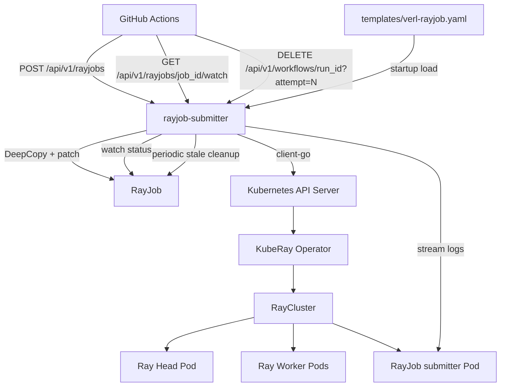

# verl RayJob Submitter 设计文档

## 目标

`rayjob-submitter` 是一个薄 HTTP 服务，让 GitHub Actions 不需要 Kubernetes 权限也能提交、观察和清理 KubeRay `RayJob`。

submitter 只负责：

- 校验请求
- 加载 `templates/verl-rayjob.yaml`
- 对模板 `DeepCopy()` 后 patch 必要字段
- 创建 RayJob
- 查询 RayJob 状态
- 输出 `/watch` 事件流
- 按 workflow run attempt 清理 RayJob
- 后台清理超过 TTL 的残留 RayJob

submitter 不理解 PPO/GRPO/MindSpeed 业务逻辑，不接收 raw shell，不接收任意 Kubernetes YAML，不执行 `kubectl`。

## 架构



## 模板 Patch

模板是基础事实源，submitter 只 patch：

- `metadata.name` / `metadata.namespace`
- RayJob labels / annotations
- `spec.entrypoint`
- `submitterPodTemplate` 容器 image/env
- head / worker 容器 image/env
- head / worker Pod labels
- worker `replicas/minReplicas/maxReplicas`
- 请求中的安全 `template_patches` 白名单路径

保留模板里的 NPU hostPath、NFS cache、Ascend env、`PYTHONPATH`、nodeSelector、workingDir、imagePullPolicy。resources、`/dev/shm` sizeLimit、rayStartParams 和部分 env 可通过安全 `template_patches` 调整。

`entrypoint` 由 `script + args` 生成：

```bash
bash -lc 'set -euxo pipefail
bash/python <script> <args...>'
```

所有参数都 shell quote。submitter 不强制切换工作目录；仓库准备、`cd /verl` 等工作目录选择由 workflow 传入的 wrapper/script 自行处理。

## API

### `POST /api/v1/rayjobs`

请求：

```json
{
  "repository": "verl-project/verl",
  "commit_sha": "0123456789abcdef0123456789abcdef01234567",
  "branch": "main",
  "github_run_id": "123456789",
  "github_run_attempt": "1",
  "image": "quay.io/albert54/verl-ci:ci-qwen3-06b-ppo-multinode",
  "name_suffix": "multinode-e2e",
  "script": "tests/special_npu/run_qwen3_06b_ppo_multinode.sh",
  "args": [],
  "env": {},
  "worker_replicas": 2,
  "template_patches": [
    {
      "op": "replace",
      "path": "/spec/rayClusterSpec/workerGroupSpecs/0/template/spec/containers/0/resources/limits/memory",
      "value": "160Gi"
    }
  ]
}
```

响应：

```json
{
  "job_id": "vrj-123456789-1-143210-multinode-e2e",
  "rayjob_name": "vrj-123456789-1-143210-multinode-e2e",
  "namespace": "ray",
  "status": "SUBMITTED",
  "message": "RayJob submitted"
}
```

### `GET /api/v1/rayjobs/{job_id}`

返回 RayJob 状态，状态来自 `.status.jobStatus` 和 `.status.jobDeploymentStatus`。

### `GET /api/v1/rayjobs/{job_id}/watch?format=ndjson`

主观察接口。输出 RayJob 状态事件、日志事件和最终事件。

NDJSON 每行一个 JSON object：

```json
{"type":"status","status":"RUNNING","message":"RayJob is running"}
{"type":"log","pod":"xxx","container":"ray-job-submitter","line":"+ npu-smi info"}
{"type":"error","message":"log stream ended: context canceled"}
{"type":"final","status":"SUCCEEDED","message":"RayJob succeeded"}
{"type":"final","status":"FAILED","job_deployment_status":"ValidationFailed","message":"RayJob failed"}
```

`error` 事件不代表 RayJob 失败，最终成败只看 `final`。

`format=text` 输出：

```text
::status::<STATUS>::<MESSAGE>
::log::<LOG_LINE>
::error::<MESSAGE>
::final::<STATUS>::<MESSAGE>
```

### `DELETE /api/v1/workflows/{github_run_id}?attempt=<github_run_attempt>`

清理某次 workflow attempt 创建的所有 RayJob。RayJob CR 完成后不会自动消失，workflow 最后应调用该接口。

## 残留任务清理

workflow DELETE 是主清理路径。为防止 GitHub 网页端强制终止导致 cleanup step 未执行，服务默认启用后台 stale cleanup：

- 每 `STALE_RAYJOB_CLEANUP_INTERVAL_SECONDS` 秒扫描一次。
- 只处理带 `ci.verl/job-id` 标签的 RayJob。
- 当 `metadata.creationTimestamp` 距当前时间超过 `STALE_RAYJOB_TTL_SECONDS` 时删除。
- 不区分 RayJob 当前状态，`RUNNING/PENDING/SUCCEEDED/FAILED/UNKNOWN` 均按 TTL 清理。
- 删除使用现有 `rayjobs list/delete` 权限，不需要额外 RBAC。

## Watch 行为

`/watch` 内部并发执行：

- status watcher：周期查询 RayJob CR，输出 status，并把终态交给协调器。
- log streamer：等待 RayJob submitter Pod，读取 `ray-job-submitter` 容器日志，逐行输出 log；EOF 或临时错误后自动重新发现 Pod 并重连。
- coordinator：收到 `SUCCEEDED/FAILED` 后停止实时读取，使用同一游标进行最多 30 秒的非 follow 补读，直到容器终止后的读取完成；所有已接受的日志和诊断之后才输出唯一 final。`TIMEOUT/NOT_FOUND` 不补读，明确提示日志可能不完整。

日志流断开只输出 error，不直接判失败。RayJob status 才是最终裁决。最终日志补读超时或不可用也不会改变原始 RayJob 结果。

`/watch` 和 `/logs/stream` 共用恢复和终态协调逻辑。独立日志接口仍输出普通文本（无 `::log::` 前缀），包含状态及恢复诊断，并在 RayJob 终态补读后关闭；它也受 `WATCH_TIMEOUT_SECONDS` 限制。客户端断连或写入/flush 失败立即取消后台工作，支持写超时的 HTTP writer 每次写入最多等待 15 秒。

首次读取每个容器只获取最近 1000 行，因此不保证包含任务开始以来的全部日志。重连请求不再带 tail 限制，以最后已接受的 Kubernetes 时间戳减去 2 秒并向下取整到秒作为 `sinceTime`；这覆盖 client-go 的秒级时间序列化。时间戳从原文中剥离，事件 `timestamp` 仍为发送时间。重放窗口按时间戳和行内容记录出现次数，保留相同时间戳的重复行。EOF/临时错误采用带抖动的指数退避（约 0.5–30 秒）；有新日志才重置退避。

恢复限制：

- 游标绑定 Pod UID、容器名、restart count 和 container ID；Pod/容器变化会重置并诊断。选择最新创建的 submitter Pod，不读取旧容器的 `previous` 日志。
- Kubernetes 已轮转或删除的日志无法恢复。时间戳乱序超过重放窗口时也不能保证完整恢复。
- 重放窗口最多跟踪 65,536 个不同记录摘要；超过后明确诊断并关闭该容器的重放去重，允许重复，保持内存有界。格式错误的时间戳行原样输出，可能重放重复；没有有效游标时重连读取所有仍保留的日志。
- 超过 4 MiB scanner 上限的行会报告不可恢复的日志缺口并停止日志读取，避免无限重试。授权错误等永久错误也停止日志读取，但状态轮询继续。
- 初始 Pod 发现仍受 `LOG_HEAD_WAIT_SECONDS` 限制；发现过 Pod 后的重连不受该初始限制。最终补读有独立的 30 秒上限，并可能延长终态响应时间。

## 命名和标签

RayJob 名称：

```text
vrj-<github_run_id>-<github_run_attempt>-<HHMMSS>-<short_name_suffix>
```

KubeRay 要求 RayJob name 不超过 47 字符，因此 submitter 会截断 suffix 并保证名称符合 DNS label。

RayJob/head/worker Pod 都追加：

```text
ci.verl/job-id=<job_id>
ci.verl/name-suffix=<name_suffix>
ci.verl/run-id=<github_run_id>
ci.github.com/run-id=<github_run_id>
ci.github.com/run-attempt=<github_run_attempt>
```

## 参数校验

- `repository` 必须等于 `ALLOWED_REPOSITORY`
- `commit_sha` 必须匹配 `^[0-9a-f]{40}$`
- `branch` 必须非空且只包含字母、数字、点、下划线、斜杠、短横线
- `github_run_id` / `github_run_attempt` 必须为数字
- `image` 必须匹配 `ALLOWED_IMAGE_PREFIXES` 中的任一前缀
- `script` 必须是 `ALLOWED_SCRIPT_PREFIXES` 中任一前缀下的 clean path，支持相对路径和绝对路径
- `args` 数量和长度受限，禁止 shell 控制字符
- `env` key 必须匹配 `^[A-Z_][A-Z0-9_]{0,63}$`
- `env` 禁止覆盖 `PATH/HOME/PYTHONPATH/LD_LIBRARY_PATH/RAY_ADDRESS/RAY_HEAD_SERVICE_HOST`
- `worker_replicas` 必须大于 0 且不超过 `MAX_WORKER_REPLICAS`
- `template_patches` 仅支持 `add/replace`，路径必须命中安全白名单，quantity 字段必须是合法 Kubernetes quantity

## 配置

```text
LISTEN_ADDR=:8080
TARGET_NAMESPACE=ray
RAYJOB_TEMPLATE_PATH=templates/verl-rayjob.yaml
WORKER_REPLICAS=2
MAX_WORKER_REPLICAS=2
ALLOWED_REPOSITORY=verl-project/verl
ALLOWED_IMAGE_PREFIXES=quay.io/ascend/verl:,quay.io/albert54/verl-ci:
LOG_HEAD_WAIT_SECONDS=1800
WATCH_TIMEOUT_SECONDS=12600
STATUS_POLL_SECONDS=30
STALE_RAYJOB_CLEANUP_ENABLED=true
STALE_RAYJOB_TTL_SECONDS=21600
STALE_RAYJOB_CLEANUP_INTERVAL_SECONDS=600
ALLOWED_SCRIPT_PREFIXES=tests/special_npu/,tests/special_e2e/,examples/data_preprocess/,/root/.cache/cicd_test/
MAX_ARGS=64
MAX_ARG_LENGTH=1024
MAX_EXTRA_ENV=64
MAX_ENV_VALUE_LENGTH=2048
MAX_TEMPLATE_PATCHES=32
MAX_TEMPLATE_PATCH_VALUE_LENGTH=2048
```

## Template Patches

`template_patches` 是受限 JSON Patch，不是任意 RayJob YAML patch。第一版只允许资源和运行参数相关路径：

- submitter/head/worker 容器 `resources.requests/*` 和 `resources.limits/*`
- head/worker `dshm` volume 的 `emptyDir.sizeLimit`
- head/worker `rayStartParams/*`
- head/worker 容器 env 追加，路径必须以 `/env/-` 结尾

当前模板数组索引固定为：

- submitter container: `/spec/submitterPodTemplate/spec/containers/0`
- head container: `/spec/rayClusterSpec/headGroupSpec/template/spec/containers/0`
- head dshm volume: `/spec/rayClusterSpec/headGroupSpec/template/spec/volumes/1`
- worker group: `/spec/rayClusterSpec/workerGroupSpecs/0`
- worker container: `/spec/rayClusterSpec/workerGroupSpecs/0/template/spec/containers/0`
- worker dshm volume: `/spec/rayClusterSpec/workerGroupSpecs/0/template/spec/volumes/1`

## RBAC

ServiceAccount 需要：

- `rayjobs`: `create/get/list/delete`
- `pods`: `list`
- `pods/log`: `get`
- `selfsubjectaccessreviews`: `create`

禁止授予 `secrets`、`pods/exec`、`cluster-admin`、`nodes`、`persistentvolumes`。
