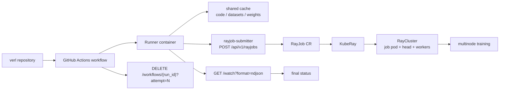

# 多机 CI 使用指南

这份文档面向把 GitHub Actions 接入 `rayjob-submitter` 的日常使用场景，重点覆盖三件事：

- 如何接入一条多机 CI workflow。
- 如何跑通一次端到端多机 RayJob。
- 失败后如何定位问题、调整参数、重新部署。

对应的展示版 HTML 在 `docs/multinode-ci-guide.html`。

## 1. 核心链路

多机 CI 的主链路是：



几个关键边界：

- GitHub Actions 不直接持有 Kubernetes 写权限，只访问 `rayjob-submitter` HTTP API。
- `rayjob-submitter` 固定加载 RayJob 模板，只允许 workflow 传入镜像、入口脚本、参数、env、worker 数和白名单 `template_patches`。
- KubeRay 负责把 RayJob 转成实际 RayCluster，包含 RayJob submitter Pod、head Pod 和 N 个 worker Pod。
- Kueue 负责多机资源准入，避免多个多机任务各抢到一部分机器后互相等待。
- shared cache 只承载共享源码、数据集和模型权重；训练启动逻辑仍由 RayJob wrapper 和 Ray worker 执行。

## 2. 前置条件

### 2.1 集群侧组件

需要先部署好：

- KubeRay operator 和 RayJob CRD。
- Kueue operator 和 Kueue CRD。
- `ray` 命名空间。
- `ci-system` 命名空间中的 `rayjob-submitter` Deployment / Service / RBAC。
- RayJob 模板中的 NPU 节点选择、驱动挂载、`/root/.cache` 共享目录、Kueue 标签与 `spec.suspend: true`。

常用部署顺序：

```bash
kubectl label namespace ray kueue-pool=ray-npu --overwrite

kubectl apply -f deploy/kueue/kueue-ray-npu-a2.yaml

kubectl apply -f deploy/rbac.yaml
kubectl apply -f deploy/deployment.yaml

kubectl -n ci-system rollout status deploy/rayjob-submitter
kubectl -n ci-system get svc rayjob-submitter
```

服务健康检查：

```bash
curl -sS http://rayjob-submitter.ci-system.svc.cluster.local/healthz
```

返回：

```json
{"status":"ok"}
```

### 2.2 submitter 关键限制

workflow 提交前会被 submitter 校验。下面这些配置决定 workflow 能传什么：

| 配置 | 作用 | 修改位置 |
| --- | --- | --- |
| `ALLOWED_REPOSITORY` | 限制来源仓库，例如 `verl-project/verl` | `deploy/deployment.yaml` |
| `ALLOWED_IMAGE_PREFIXES` | 限制可使用的镜像前缀 | `deploy/deployment.yaml` |
| `ALLOWED_SCRIPT_PREFIXES` | 限制入口脚本路径前缀 | `deploy/deployment.yaml` |
| `WORKER_REPLICAS` | 默认 worker 数 | `deploy/deployment.yaml` |
| `MAX_WORKER_REPLICAS` | 单次提交允许的最大 worker 数 | `deploy/deployment.yaml` |
| `WATCH_TIMEOUT_SECONDS` | watch 等待总超时 | `deploy/deployment.yaml` |
| `LOG_HEAD_WAIT_SECONDS` | 等待 RayJob submitter Pod 日志的时间 | `deploy/deployment.yaml` |
| `MAX_TEMPLATE_PATCHES` | 单次提交允许的最大 patch 数 | `deploy/deployment.yaml` |
| `RAYJOB_TEMPLATE_PATH` | submitter 加载的模板路径 | `deploy/deployment.yaml` |

更新这些 env 后：

```bash
kubectl apply -f deploy/deployment.yaml
kubectl -n ci-system rollout status deploy/rayjob-submitter
```

### 2.3 shared cache

Runner、RayJob submitter Pod、head/worker Pod 需要看到同一份 `/root/.cache`。

workflow 会把当前 checkout 复制到：

```text
/root/.cache/cicd_test/verl
```

RayJob wrapper 会从 shared cache 读取源码、数据集和权重，再在 RayJob submitter Pod 与所有 worker 上准备 `/verl`。

## 3. GitHub Actions 接入方式

可以参考 verl 仓库里的 workflow：

- <https://github.com/verl-project/verl/blob/main/.github/workflows/nightly_ascend_multinode.yml>

端到端通过样例：

- <https://github.com/verl-project/verl/actions/runs/28231225229/job/83635714775>

### 3.1 workflow 基础 env

```yaml
env:
  SUBMITTER_URL: http://rayjob-submitter.ci-system.svc.cluster.local
  IMAGE: swr.cn-southwest-2.myhuaweicloud.com/modelfoundry/ascend-ci/verl/verl:verl-9.0.0-a3-ubuntu22.04-py3.11-latest
  WORKER_REPLICAS: "2"
```

注意：

- `IMAGE` 必须匹配 `ALLOWED_IMAGE_PREFIXES`。
- `WORKER_REPLICAS` 不能超过 `MAX_WORKER_REPLICAS`。
- 如果使用 Kueue，模板和 Kueue quota 也要支持对应资源规模。

### 3.2 复制源码到 shared cache

```yaml
- name: Copy checkout to shared cache
  run: |
    rm -rf /root/.cache/cicd_test/verl
    mkdir -p /root/.cache/cicd_test/verl
    tar --exclude=.git -cf - . | tar -xf - -C /root/.cache/cicd_test/verl
```

如果后续出现 `/root/.cache/cicd_test/verl not found`，第一步就检查这个 step 是否成功执行，以及 RayJob Pod 是否挂载同一份 `/root/.cache`。

### 3.3 RayJob wrapper

提交给 submitter 的 `script` 通常是：

```text
/root/.cache/cicd_test/run_multinode_testing.sh
```

真实训练脚本通过参数传给 wrapper：

```json
["--script-path", "/verl/tests/special_npu/run_gspo_qwen3_30b_megatron_npu_multinode.sh"]
```

这表示：

- submitter 生成 RayJob entrypoint。
- RayJob submitter Pod 启动 wrapper。
- wrapper 准备 `/verl`，再通过 Ray 调度让 worker 执行初始化和训练。

### 3.4 提交 helper

下面这个 helper 完成提交、watch 和最终状态判断。它支持第五个参数 `template_patches_json`。

```bash
cat > /root/.cache/cicd_test/submit_and_wait_rayjob.sh <<'EOF'
#!/usr/bin/env bash
set -euo pipefail

name_suffix="$1"
script="$2"
args_json="${3:-[]}"
env_json="${4:-{}}"
template_patches_json="${5:-[]}"

: "${SUBMITTER_URL:?SUBMITTER_URL is required}"
: "${IMAGE:?IMAGE is required}"
: "${GITHUB_REPOSITORY:?GITHUB_REPOSITORY is required}"
: "${GITHUB_SHA:?GITHUB_SHA is required}"
: "${GITHUB_REF_NAME:?GITHUB_REF_NAME is required}"
: "${GITHUB_RUN_ID:?GITHUB_RUN_ID is required}"

github_run_attempt="${GITHUB_RUN_ATTEMPT:-1}"
worker_replicas="${WORKER_REPLICAS:-2}"

payload="$(jq -n \
  --arg repository "${GITHUB_REPOSITORY}" \
  --arg commit_sha "${GITHUB_SHA}" \
  --arg branch "${GITHUB_REF_NAME}" \
  --arg github_run_id "${GITHUB_RUN_ID}" \
  --arg github_run_attempt "${github_run_attempt}" \
  --arg image "${IMAGE}" \
  --arg name_suffix "${name_suffix}" \
  --arg script "${script}" \
  --argjson args "${args_json}" \
  --argjson env "${env_json}" \
  --argjson worker_replicas "${worker_replicas}" \
  --argjson template_patches "${template_patches_json}" \
  '{
    repository: $repository,
    commit_sha: $commit_sha,
    branch: $branch,
    github_run_id: $github_run_id,
    github_run_attempt: $github_run_attempt,
    image: $image,
    name_suffix: $name_suffix,
    script: $script,
    args: $args,
    env: $env,
    worker_replicas: $worker_replicas,
    template_patches: $template_patches
  }')"

response="$(curl -sS -X POST "${SUBMITTER_URL}/api/v1/rayjobs" \
  -H "Content-Type: application/json" \
  -d "${payload}")"
echo "${response}" | jq .

job_id="$(printf '%s' "${response}" | jq -r '.job_id // empty')"
if [[ -z "${job_id}" || "${job_id}" == "null" ]]; then
  echo "RayJob submit failed."
  exit 1
fi

final_status_file="/tmp/rayjob-final-status-${job_id}"
rm -f "${final_status_file}"

set +e
curl -N -sS \
  "${SUBMITTER_URL}/api/v1/rayjobs/${job_id}/watch?format=ndjson" |
while IFS= read -r event; do
  [[ -z "${event}" ]] && continue
  type="$(printf '%s' "${event}" | jq -r '.type // empty')"
  case "${type}" in
    log)
      printf '%s' "${event}" | jq -r '.line // ""'
      ;;
    status)
      printf '%s' "${event}" |
        jq -r '"[rayjob status] " + (.status // "UNKNOWN") + " " + (.message // "")'
      ;;
    error)
      printf '%s' "${event}" |
        jq -r '"[rayjob error] " + (.message // "")'
      ;;
    final)
      status="$(printf '%s' "${event}" | jq -r '.status // "UNKNOWN"')"
      printf '%s' "${event}" |
        jq -r '"[rayjob final] " + (.status // "UNKNOWN") + " " + (.message // "")'
      printf '%s' "${status}" > "${final_status_file}"
      ;;
    *)
      printf '%s\n' "${event}"
      ;;
  esac
done
set -e

final_status=""
[[ -f "${final_status_file}" ]] && final_status="$(cat "${final_status_file}")"
case "${final_status}" in
  SUCCEEDED) exit 0 ;;
  FAILED|TIMEOUT|NOT_FOUND) exit 1 ;;
  *) echo "Watch ended without successful final status."; exit 1 ;;
esac
EOF

chmod +x /root/.cache/cicd_test/submit_and_wait_rayjob.sh
```

### 3.5 运行一个端到端任务

```yaml
- name: Run multinode RayJob
  run: |
    args_json='[
      "--script-path",
      "/verl/tests/special_npu/run_gspo_qwen3_30b_megatron_npu_multinode.sh"
    ]'

    env_json='{}'

    patches_json='[
      {
        "op": "replace",
        "path": "/spec/rayClusterSpec/workerGroupSpecs/0/template/spec/containers/0/resources/requests/cpu",
        "value": "64"
      },
      {
        "op": "replace",
        "path": "/spec/rayClusterSpec/workerGroupSpecs/0/template/spec/containers/0/resources/requests/memory",
        "value": "512Gi"
      },
      {
        "op": "replace",
        "path": "/spec/rayClusterSpec/workerGroupSpecs/0/template/spec/containers/0/resources/requests/huawei.com~1ascend-1980",
        "value": "16"
      },
      {
        "op": "replace",
        "path": "/spec/rayClusterSpec/workerGroupSpecs/0/template/spec/containers/0/resources/limits/cpu",
        "value": "64"
      },
      {
        "op": "replace",
        "path": "/spec/rayClusterSpec/workerGroupSpecs/0/template/spec/containers/0/resources/limits/memory",
        "value": "512Gi"
      },
      {
        "op": "replace",
        "path": "/spec/rayClusterSpec/workerGroupSpecs/0/template/spec/containers/0/resources/limits/huawei.com~1ascend-1980",
        "value": "16"
      },
      {
        "op": "replace",
        "path": "/spec/rayClusterSpec/workerGroupSpecs/0/template/spec/volumes/1/emptyDir/sizeLimit",
        "value": "128Gi"
      }
    ]'

    /root/.cache/cicd_test/submit_and_wait_rayjob.sh \
      multinode-e2e \
      /root/.cache/cicd_test/run_multinode_testing.sh \
      "${args_json}" \
      "${env_json}" \
      "${patches_json}"
```

### 3.6 固定 cleanup

workflow 最后一定要清理本次 attempt 创建的 RayJob：

```yaml
- name: Cleanup RayJobs
  if: always()
  run: |
    curl -sS -X DELETE \
      "${SUBMITTER_URL}/api/v1/workflows/${GITHUB_RUN_ID}?attempt=${GITHUB_RUN_ATTEMPT:-1}"
```

后台 stale cleanup 是兜底机制，不替代 workflow 主动 cleanup。默认每 600 秒扫描一次，删除带 `ci.verl/job-id` 标签且创建超过 21600 秒的 RayJob。

## 4. submitter API

### 4.1 提交 RayJob

```http
POST /api/v1/rayjobs
```

请求字段：

| 字段 | 说明 |
| --- | --- |
| `repository` | GitHub 仓库，必须等于 `ALLOWED_REPOSITORY` |
| `commit_sha` | 40 位小写 hex SHA |
| `branch` | 分支或 ref 名称 |
| `github_run_id` | GitHub Actions run id |
| `github_run_attempt` | GitHub Actions attempt |
| `image` | RayJob submitter/head/worker 镜像 |
| `name_suffix` | RayJob 名称后缀，例如 `multinode-e2e` |
| `script` | RayJob entrypoint 脚本，常用 wrapper 路径 |
| `args` | 传给脚本的参数 |
| `env` | 额外 env，不允许覆盖保护变量 |
| `worker_replicas` | worker Pod 数 |
| `template_patches` | 安全白名单 JSON Patch |

成功响应：

```json
{
  "job_id": "vrj-28231225229-1-085708-multinode-e2e",
  "rayjob_name": "vrj-28231225229-1-085708-multinode-e2e",
  "namespace": "ray",
  "status": "SUBMITTED",
  "message": "RayJob submitted"
}
```

### 4.2 观察状态和日志

```http
GET /api/v1/rayjobs/{job_id}/watch?format=ndjson
```

事件类型：

| 类型 | 含义 |
| --- | --- |
| `status` | RayJob 归一化状态，例如 `PENDING`、`RUNNING` |
| `log` | RayJob submitter Pod 的日志行 |
| `error` | watch 或日志流中的非最终错误 |
| `final` | 最终结果，只以这个事件判断 CI 成败 |

`error` 不等于任务失败。CI 成败只看 `final.status`：

- `SUCCEEDED`: 成功。
- `FAILED`: RayJob 失败。
- `TIMEOUT`: watch 超时。
- `NOT_FOUND`: RayJob 被删或未找到。

### 4.3 查询单个 RayJob

```http
GET /api/v1/rayjobs/{job_id}
```

用于临时排障，返回 submitter 归一化状态、KubeRay `jobStatus` 和 `jobDeploymentStatus`。

### 4.4 清理 workflow attempt

```http
DELETE /api/v1/workflows/{github_run_id}?attempt=N
```

删除同一个 GitHub run attempt 创建的所有 RayJob。

## 5. template_patches 调资源

`template_patches` 是受限 JSON Patch，不是任意 RayJob YAML patch。

支持：

- `op`: 只支持 `add` 和 `replace`。
- `value`: 资源和 dshm 必须是合法 Kubernetes quantity，例如 `512Gi`、`64`。
- JSON Pointer 中的 `/` 要写成 `~1`，例如 `huawei.com/ascend-1980` 写成 `huawei.com~1ascend-1980`。

允许路径：

| 目标 | 路径形态 |
| --- | --- |
| submitter 容器资源 | `/spec/submitterPodTemplate/spec/containers/0/resources/{requests,limits}/*` |
| head 容器资源 | `/spec/rayClusterSpec/headGroupSpec/template/spec/containers/0/resources/{requests,limits}/*` |
| worker 容器资源 | `/spec/rayClusterSpec/workerGroupSpecs/0/template/spec/containers/0/resources/{requests,limits}/*` |
| head dshm | `/spec/rayClusterSpec/headGroupSpec/template/spec/volumes/1/emptyDir/sizeLimit` |
| worker dshm | `/spec/rayClusterSpec/workerGroupSpecs/0/template/spec/volumes/1/emptyDir/sizeLimit` |
| head Ray 参数 | `/spec/rayClusterSpec/headGroupSpec/rayStartParams/*` |
| worker Ray 参数 | `/spec/rayClusterSpec/workerGroupSpecs/0/rayStartParams/*` |
| head/worker env 追加 | 以 `/env/-` 结尾，只能 `add` |

禁止 patch：

- `metadata`
- `spec.entrypoint`
- 容器 `image`
- `hostPath`
- `volumeMounts`
- `securityContext`
- `serviceAccountName`
- `nodeSelector`
- `affinity`
- `tolerations`
- 任意非白名单 `volumes`

常用 patch：

```json
[
  {
    "op": "replace",
    "path": "/spec/rayClusterSpec/workerGroupSpecs/0/template/spec/containers/0/resources/limits/memory",
    "value": "512Gi"
  },
  {
    "op": "replace",
    "path": "/spec/rayClusterSpec/workerGroupSpecs/0/template/spec/volumes/1/emptyDir/sizeLimit",
    "value": "128Gi"
  },
  {
    "op": "add",
    "path": "/spec/rayClusterSpec/workerGroupSpecs/0/rayStartParams/memory-usage-threshold",
    "value": "0.98"
  },
  {
    "op": "add",
    "path": "/spec/rayClusterSpec/workerGroupSpecs/0/template/spec/containers/0/env/-",
    "value": {"name": "RAY_memory_usage_threshold", "value": "0.98"}
  }
]
```

保护 env 包含：

- `PATH`
- `HOME`
- `PYTHONPATH`
- `LD_LIBRARY_PATH`
- `RAY_ADDRESS`
- `RAY_HEAD_SERVICE_HOST`

## 6. 端到端运行检查

一次成功的端到端多机 CI 在 GitHub Actions 日志中会出现这些信号：

1. `POST /api/v1/rayjobs` 返回 `job_id`。
2. watch 输出 `PENDING` 或 `RUNNING` 状态。
3. RayJob submitter Pod 日志开始回流。
4. wrapper 完成源码同步、安装和 worker 初始化。
5. 训练脚本开始输出训练日志。
6. watch 输出 `final` 事件，`status=SUCCEEDED`。
7. `Cleanup RayJobs` step 执行 DELETE。

有 Kubernetes 权限时，可以同步观察：

```bash
kubectl -n ray get rayjobs
kubectl -n ray get pods -l ci.verl/job-id=<job_id> -o wide
kubectl -n ray describe rayjob <job_id>
kubectl -n ray logs -l ci.verl/job-id=<job_id> --all-containers --tail=200
```

Kueue 相关：

```bash
kubectl -n ray get localqueue
kubectl get clusterqueue
kubectl get workload -A | grep <job_id>
kubectl describe clusterqueue ray-npu-cq
```

## 7. 排障路径

排障按层次推进，先看最靠近 workflow 的信号，再进入 RayJob / Kubernetes / 训练脚本。

### 7.1 workflow 提交前

检查：

```bash
curl -sS "${SUBMITTER_URL}/healthz"
```

常见问题：

- DNS 无法解析 `rayjob-submitter.ci-system.svc.cluster.local`。
- Runner 不在能访问集群 Service DNS 的网络里。
- `SUBMITTER_URL` 写错。

处理：

- 确认 runner 运行环境能访问集群内 Service。
- 临时用 port-forward 验证 submitter 服务本身是否正常。
- 检查 `ci-system` 中 `rayjob-submitter` readiness。

### 7.2 POST 返回 4xx

这类问题是 submitter 校验失败，RayJob 不会被创建。

| 响应信息 | 常见原因 | 处理 |
| --- | --- | --- |
| `repository is not allowed` | workflow 仓库不等于 `ALLOWED_REPOSITORY` | 修改 `deploy/deployment.yaml` 或改回允许仓库 |
| `image is not allowed` | 镜像前缀不在 `ALLOWED_IMAGE_PREFIXES` | 增加镜像前缀后重新部署 submitter |
| `script prefix is not allowed` | `script` 不在允许目录下 | 调整 workflow 路径或修改 `ALLOWED_SCRIPT_PREFIXES` |
| `worker_replicas is not allowed` | 超过 `MAX_WORKER_REPLICAS` | 降低 workflow worker 数，或提高上限并确认集群容量 |
| `too many args` | 参数数量超过 `MAX_ARGS` | 精简参数或提高上限 |
| `arg contains unsafe characters` | 参数包含换行、管道、重定向等危险字符 | 改成脚本内部配置或使用安全参数形式 |
| `env key is protected` | 覆盖了保护 env | 改用非保护 env，或把默认 env 固化到模板 |
| `path is not allowed` | `template_patches` 命中禁止路径 | 只 patch 白名单资源、dshm、Ray 参数、env append |
| `template patch value must be a Kubernetes quantity` | memory/cpu/dshm/NPU value 格式非法 | 使用 `512Gi`、`64`、`16` 这类合法 quantity |

### 7.3 Kueue 一直排队

现象：

- RayJob 创建成功，但 worker Pod 不启动。
- Kueue workload 保持 pending / inadmissible。
- 多个多机任务同时存在时，资源看似有空闲但没有完整 N x M 拓扑。

检查：

```bash
kubectl get workload -A | grep <job_id>
kubectl describe workload -n ray <workload_name>
kubectl describe clusterqueue ray-npu-cq
kubectl -n ray get localqueue default
kubectl get ns ray --show-labels
```

处理：

- 确认 `ray` namespace 有 `kueue-pool=ray-npu`。
- 确认 RayJob 模板包含 `kueue.x-k8s.io/queue-name` 和优先级标签。
- 确认 RayJob 模板有 `spec.suspend: true`。
- 确认 `ClusterQueue` quota 覆盖 CPU、memory 和实际 NPU resource key。
- 确认每个 worker 请求的 NPU 数、worker 数和队列 quota 能整组满足。

### 7.4 RayJob submitter Pod 没有日志

现象：

- `/watch` 里持续 `waiting for RayJob submitter pod`。
- 或出现 `timed out waiting for RayJob submitter pod`。

检查：

```bash
kubectl -n ray get pods -l ci.verl/job-id=<job_id> -o wide
kubectl -n ray describe rayjob <job_id>
kubectl -n ray describe pod <rayjob_submitter_pod>
```

常见原因：

- 镜像拉取失败。
- Kueue 未放行。
- RayJob submitter Pod 调度失败。
- 模板资源过高。
- 节点 selector 与硬件池不匹配。

处理：

- 修正镜像或 imagePullSecret。
- 修正 Kueue quota / ResourceFlavor / namespace label。
- 降低 submitter Pod 资源请求。
- 确认模板中的 nodeSelector 与目标节点标签一致。

### 7.5 `/root/.cache/cicd_test/verl` 不存在

现象：

- wrapper 报源码目录不存在。
- worker 初始化时找不到 `/verl` 或找不到训练脚本。

检查：

- workflow 的 `Copy checkout to shared cache` step 是否执行成功。
- RayJob submitter Pod 和 worker 是否挂载同一份 `/root/.cache`。
- `script` 是否指向 `/root/.cache/cicd_test/run_multinode_testing.sh`。
- `args` 中 `--script-path` 是否指向容器内 `/verl/...`。

处理：

- 修复 workflow 中复制 checkout 的步骤。
- 修复模板中 `/root/.cache` 的 volume/volumeMount。
- 确认 wrapper 有执行权限。
- 确认训练脚本已经在当前 checkout 中存在。

### 7.6 worker 数量不对

现象：

- wrapper 等不到期望 worker 数。
- Ray actor 只在部分 worker 上启动。
- 训练脚本看到的节点数和 workflow 设置不一致。

检查：

```bash
kubectl -n ray get pods -l ci.verl/job-id=<job_id> -o wide
kubectl -n ray describe rayjob <job_id>
```

处理：

- 确认 workflow `WORKER_REPLICAS`。
- 确认 submitter `MAX_WORKER_REPLICAS`。
- 确认 RayJob 渲染后 worker group 的 `replicas/minReplicas/maxReplicas`。
- 确认 Kueue quota 足够一次性放行全部 worker。

### 7.7 OOM 或容器被杀

现象：

- Ray 报 `OutOfMemoryError`。
- Pod `OOMKilled`。
- 训练日志中 object store 或 worker 内存不足。

处理顺序：

1. 通过 `template_patches` 提高 worker memory request/limit。
2. 提高 worker `/dev/shm`。
3. 追加或调整 Ray memory 参数，例如 `memory-usage-threshold`。
4. 降低训练 batch。
5. 打开 offload 或调整并行策略。
6. 确认数据集和模型权重缓存不会挤占训练内存。

常用 patch：

```json
[
  {
    "op": "replace",
    "path": "/spec/rayClusterSpec/workerGroupSpecs/0/template/spec/containers/0/resources/limits/memory",
    "value": "512Gi"
  },
  {
    "op": "replace",
    "path": "/spec/rayClusterSpec/workerGroupSpecs/0/template/spec/volumes/1/emptyDir/sizeLimit",
    "value": "128Gi"
  },
  {
    "op": "add",
    "path": "/spec/rayClusterSpec/workerGroupSpecs/0/rayStartParams/memory-usage-threshold",
    "value": "0.98"
  }
]
```

### 7.8 batch 与 data parallel size 不匹配

典型错误：

```text
AssertionError: Got mini_batch_size=16 and self.engine.get_data_parallel_size()=32
```

含义：

- 当前训练实际 data parallel size 是 32。
- mini batch 是 16，不能被 DP size 整除。

计算方式：

```text
data_parallel_size = worker_replicas x 每个 worker 使用的 NPU 数
```

例如：

```text
2 workers x 16 NPU = 32
```

处理：

- 把 mini batch 调整为 32、64 等能被 DP size 整除的值。
- 或降低 worker 数 / 每 worker NPU 数。
- 同步检查 global batch、micro batch、model parallel、pipeline parallel 和 rollout 配置。

### 7.9 watch 超时

现象：

- final status 是 `TIMEOUT`。
- 训练仍在跑，但 submitter watch 已超时。

处理：

- 提高 `WATCH_TIMEOUT_SECONDS` 后重新部署 submitter。
- 排队时间很长时，把 Kueue 等待时间也算进 timeout。
- 区分“任务真的卡住”和“任务正常训练但超过 CI 预算”。

### 7.10 cleanup 后仍有残留资源

检查：

```bash
kubectl -n ray get rayjobs -l ci.verl/github-run-id=<GITHUB_RUN_ID>
kubectl -n ray get pods -l ci.verl/github-run-id=<GITHUB_RUN_ID>
```

处理：

- 确认 workflow 最后一段 `Cleanup RayJobs` 使用 `if: always()`。
- 确认 DELETE URL 中的 `GITHUB_RUN_ID` 和 `GITHUB_RUN_ATTEMPT` 正确。
- 确认 submitter 有 RayJob delete 权限。
- 依赖后台 stale cleanup 兜底时，默认 6 小时后才会删除。

## 8. 修改后如何重新部署

| 修改内容 | 修改位置 | 验证方式 |
| --- | --- | --- |
| workflow 脚本、训练脚本、args、合法 patch | 业务仓库 workflow / tests | 重新跑 GitHub Actions |
| 镜像白名单、脚本白名单、worker 上限、timeout | `deploy/deployment.yaml` | `kubectl apply -f deploy/deployment.yaml` |
| Kueue quota、ResourceFlavor、LocalQueue | `deploy/kueue/*.yaml` | `kubectl apply -f deploy/kueue/...` |
| RayJob 模板内容 | `templates/verl-rayjob*.yaml` | 重新构建 submitter 镜像并更新 Deployment |
| patch 白名单、保护 env、参数字符规则 | Go 代码 | `go test ./...`、`go vet ./...`、`go build ./cmd/rayjob-submitter` 后发版 |

部署后固定检查：

```bash
kubectl -n ci-system rollout status deploy/rayjob-submitter
kubectl -n ci-system get deploy rayjob-submitter \
  -o jsonpath='{.spec.template.spec.containers[0].env}'
curl -sS http://rayjob-submitter.ci-system.svc.cluster.local/healthz
```

## 9. 失败时需要收集的信息

提交问题前，至少保留这些信息：

- GitHub Actions run URL。
- `POST /api/v1/rayjobs` 响应体。
- `job_id`。
- `/watch?format=ndjson` 中最后 200 行。
- `final` 事件内容。
- 训练脚本路径和 args。
- `template_patches`。
- `WORKER_REPLICAS`、镜像、分支、commit。

有集群权限时补充：

```bash
kubectl -n ray describe rayjob <job_id>
kubectl -n ray get pods -l ci.verl/job-id=<job_id> -o wide
kubectl -n ray describe pods -l ci.verl/job-id=<job_id>
kubectl -n ray logs -l ci.verl/job-id=<job_id> --all-containers --tail=300
kubectl get workload -A | grep <job_id>
kubectl describe clusterqueue ray-npu-cq
```

## 10. 快速检查清单

跑端到端多机 CI 前：

- [ ] `rayjob-submitter` `/healthz` 可访问。
- [ ] `IMAGE` 匹配 `ALLOWED_IMAGE_PREFIXES`。
- [ ] `script` 匹配 `ALLOWED_SCRIPT_PREFIXES`。
- [ ] `WORKER_REPLICAS <= MAX_WORKER_REPLICAS`。
- [ ] shared cache 中有当前 checkout。
- [ ] wrapper 存在且可执行。
- [ ] `--script-path` 指向容器内 `/verl/...`。
- [ ] `template_patches` 只 patch 白名单路径。
- [ ] NPU resource key 与模板和集群一致。
- [ ] Kueue namespace label、LocalQueue、ClusterQueue、ResourceFlavor 已生效。
- [ ] 训练 batch 能被 data parallel size 整除。
- [ ] workflow 最后有 `if: always()` cleanup。
